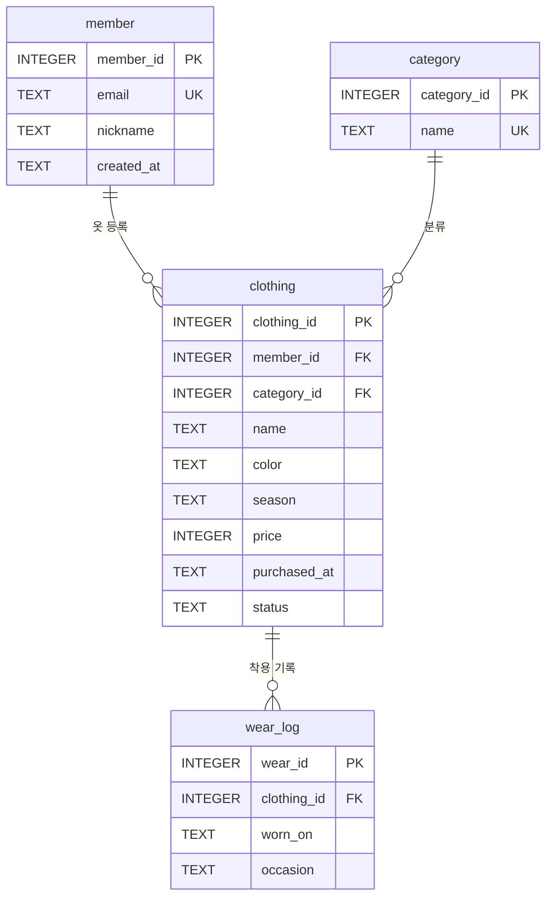
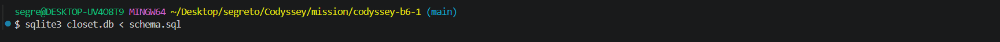
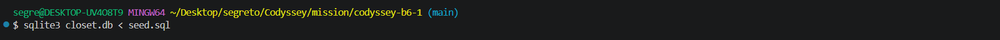
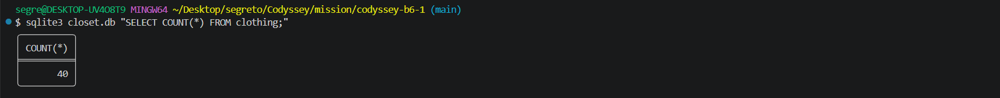
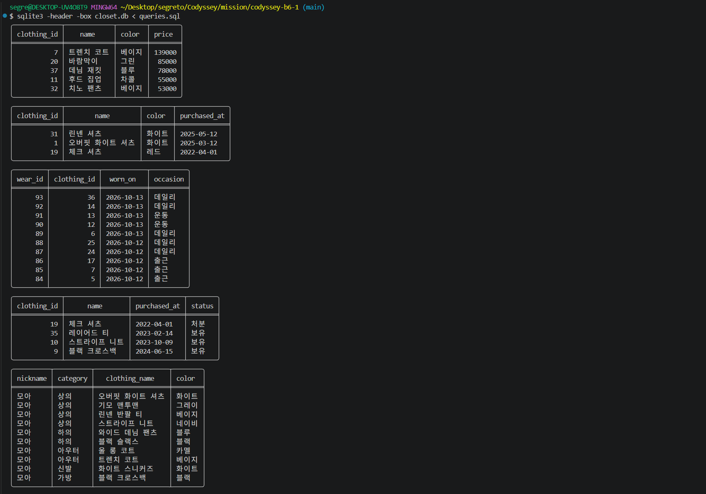
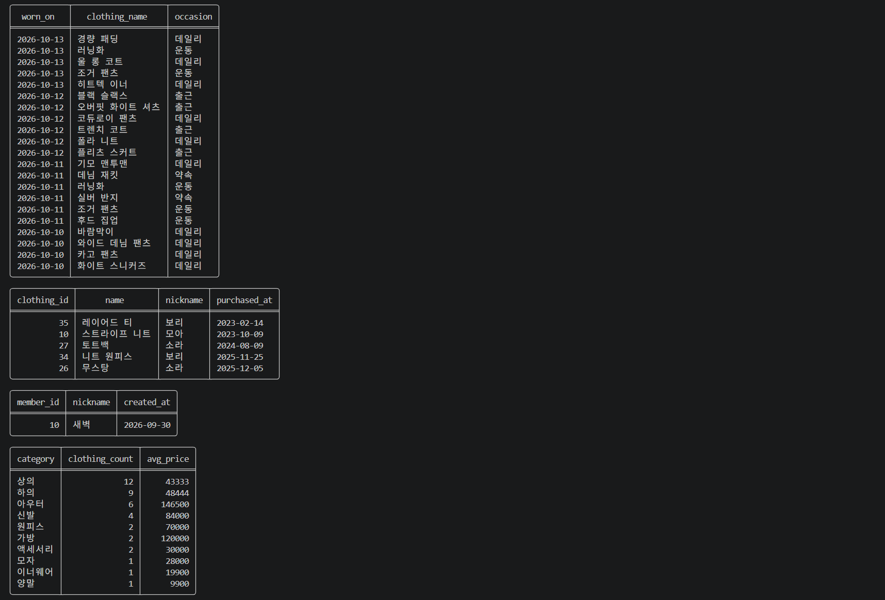
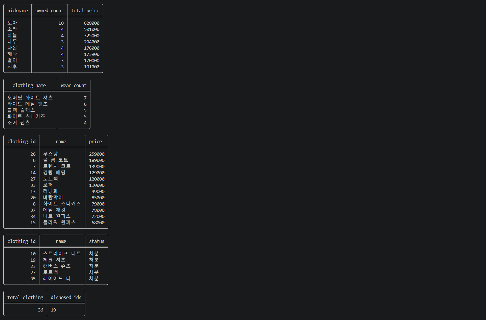
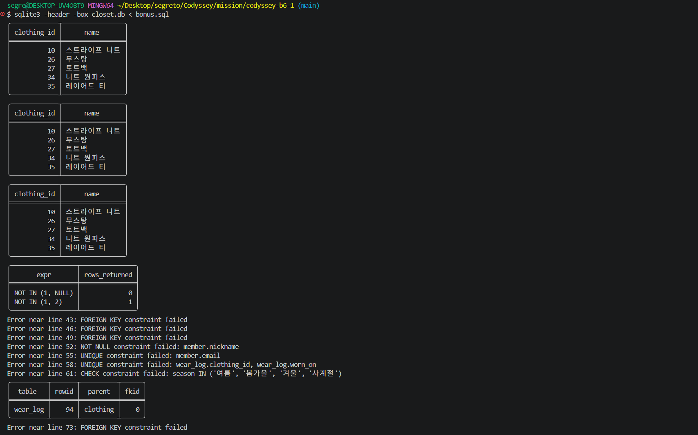
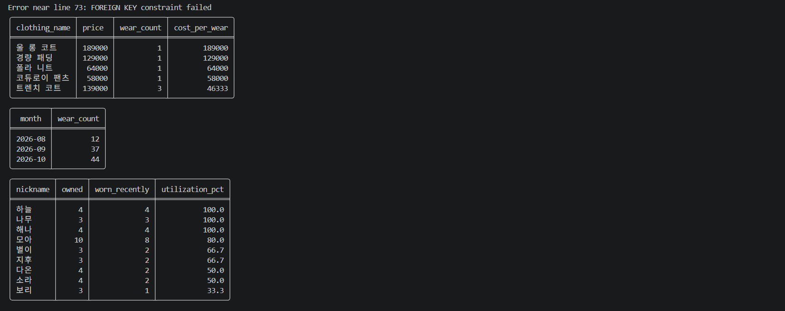
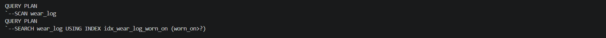

<div align="center">

# 👗 옷장 관리 DB — 디지털 서랍장

### 4개 테이블 · 3개 1:N 관계 · 핵심 쿼리 15개 · 보너스 3종 (SQLite)


</div>

> 엑셀과 DB의 차이는 "데이터 양"이 아니라 "관계"입니다. 옷·카테고리·주인·착용 기록을 테이블로 쪼개고 FK로 이어서, 요구사항을 SQL 한 문장으로 꺼내는 흐름을 직접 만들어 봤습니다.

**미션**: B6-1 · 정보를 깔끔하게 정리하는 디지털 서랍장 만들기

## 프로젝트 개요

주제는 **옷장 관리**입니다. 옷을 등록하고(`clothing`), 종류별로 분류하고(`category`), 누가 가진 옷인지(`member`), 언제 입었는지(`wear_log`)를 기록하는 서비스를 가정하고 데이터 모델을 설계했습니다. 도서 대여처럼 예시로 나온 주제 대신, 나중에 실제 앱으로 만들어 볼 도메인을 골라서 "이 구조로 진짜 서비스 쿼리가 나오는가"를 기준으로 설계했습니다.

설계 기준은 **"관계가 자연스럽고 쿼리가 잘 나오는 구조"** 입니다. 옷 한 벌에는 주인 1명, 카테고리 1개, 착용 기록 여러 개가 붙습니다. 그래서 `member 1 : N clothing`, `category 1 : N clothing`, `clothing 1 : N wear_log` 세 개의 1:N 관계가 나왔고, "안 입는 옷 찾기", "착용당 비용" 같은 옷장 서비스 특유의 요구를 JOIN과 GROUP BY로 풀 수 있게 됐습니다.



같은 구조의 ERD 이미지는 `erd.png`로도 함께 제출합니다.

| 테이블 | 역할 | 행 수 | 적용한 제약조건 |
|---|---|---|---|
| `member` | 옷장을 쓰는 회원 | 10 | `PK`, `email UNIQUE`, `nickname NOT NULL` |
| `category` | 상의/하의/아우터 등 종류 | 10 | `PK`, `name UNIQUE` |
| `clothing` | 등록한 옷 | 40 | `PK`, `FK ×2`, `CHECK`(계절·상태·가격), `NOT NULL` |
| `wear_log` | 착용 기록 | 93 | `PK`, `FK`, `UNIQUE(clothing_id, worn_on)` |

## 주요 기능

### 제출물과 요구사항 대응

| 요구사항 | 파일 | 내용 |
|---|---|---|
| 스키마 생성 스크립트 1개 | `schema.sql` | 테이블 4개, PK/FK/UNIQUE/NOT NULL/CHECK |
| 샘플 데이터 INSERT 1개 | `seed.sql` | 테이블당 10행 이상, 부모 → 자식 순서 |
| 쿼리 15개 SQL 1개 | `queries.sql` | 쿼리마다 한 줄 설명 주석 포함 |
| 실행 결과 캡처 폴더 1개 | `results/` | 쿼리별 결과 텍스트 `q01.txt` ~ `q15.txt` + 실제 실행 화면 `results/screenshots/` |
| (선택) ERD 이미지 1개 | `erd.png` | 이 README의 Mermaid 다이어그램과 같은 구조 |
| (보너스) | `bonus.sql`, `results/bonus_*.txt` | JOIN vs 서브쿼리 비교 · 정합성 깨뜨리기 · 미니 리포트 |

### 쿼리 15개 한눈에 보기

| 번호 | 분류 | 무엇을 확인하나 |
|---|---|---|
| `Q01` | 기본 조회 | 봄가을 옷 중 비싼 순 TOP 5 (`WHERE` + `ORDER BY` + `LIMIT`) |
| `Q02` | 기본 조회 | 이름에 '셔츠'가 들어간 옷 검색 (`LIKE`) |
| `Q03` | 기본 조회 | 최근 30일 착용 기록 (날짜 범위) |
| `Q04` | 기본 조회 | 가격 미입력 옷 (`IS NULL`) |
| `Q05` | `INNER JOIN` | 회원·카테고리·옷 3개 테이블 조인 |
| `Q06` | `INNER JOIN` | 최근 4일 착용 기록에 옷 이름 붙이기 |
| `Q07` | `LEFT JOIN` | 한 번도 안 입은 보유 옷 |
| `Q08` | `LEFT JOIN` | 옷을 등록하지 않은 회원 |
| `Q09` | 집계 | 카테고리별 개수·평균 가격 (`COUNT`, `AVG`, `GROUP BY`) |
| `Q10` | 집계 | 회원별 보유 옷 구매금액 합계 (`SUM`, `HAVING`) |
| `Q11` | 집계 | 가장 많이 입은 옷 TOP 5 (랭킹) |
| `Q12` | 서브쿼리 | 전체 평균 가격보다 비싼 옷 |
| `Q13` | `UPDATE` | 구매한 지 1년이 넘었는데 착용 기록이 없는 옷을 '처분'으로 변경 |
| `Q14` | `DELETE` | '처분'이면서 착용 기록 없는 옷 삭제 |
| `Q15` | `INDEX` | `wear_log.worn_on` 인덱스 생성, 실행 계획 전/후 비교 |

## 개발 환경

- 언어/런타임: SQL (SQLite 3.x) · 결과 캡처 보조 스크립트만 Python 3.10+
- 주요 도구: `sqlite3` CLI 또는 DBeaver 등 SQL 클라이언트
- 외부 라이브러리: 없음 (Python 표준 라이브러리 `sqlite3`만 사용)
- 실행/배포 방식: 로컬 파일 DB (`closet.db`), 별도 서버 불필요
- 실행 확인 환경: Windows + Git Bash, `sqlite3` 3.52.0
- 제약 준수: 백엔드 프레임워크, 뷰·프로시저·트리거 미사용

## 배포 & 실행 방법

- GitHub 저장소: https://github.com/segretoo/codyssey-b6-1

```bash
# 1) 스키마 → 2) 샘플 데이터 → 3) 쿼리 순서로 실행
sqlite3 closet.db < schema.sql
sqlite3 closet.db < seed.sql
sqlite3 closet.db < queries.sql

# 보너스 과제는 queries.sql이 데이터를 바꾸기 전, 깨끗한 DB에서 실행
rm -f closet.db
sqlite3 closet.db < schema.sql
sqlite3 closet.db < seed.sql
sqlite3 closet.db < bonus.sql

# 결과 캡처(results/ 폴더)를 쿼리별로 다시 만들고 싶다면
python3 tools/run_queries.py
```

### 실행 화면

스키마 적용 → 샘플 데이터 입력 → `clothing` 행 수(40) 확인 순서로 실행했습니다.







`queries.sql` 실행 결과입니다. 표는 쿼리 순서대로 출력됩니다. `Q13`(`UPDATE`)과 `Q14`(`DELETE`)는 변경 행 수를 출력하지 않아서, 바로 아래에 둔 확인용 `SELECT`가 표로 나옵니다.

`Q01`~`Q05`



`Q06`~`Q09`



`Q10`~`Q14` (마지막 두 표는 `Q13`, `Q14`의 확인용 `SELECT`)



`Q15`의 실행 계획 스크린샷은 아래 "학습 목표 & 설명"의 인덱스 설명 옆에 있습니다.

## 프로젝트 구조

```
codyssey-b6-1/
├── schema.sql
├── seed.sql
├── queries.sql
├── bonus.sql
├── erd.png
├── results/
│   ├── q01.txt ~ q15.txt
│   ├── bonus_*.txt
│   ├── 00_all_queries.txt
│   ├── 00_all_bonus.txt
│   └── screenshots/
│       ├── 01 ~ 03  (스키마·데이터 적용, 행 수 확인)
│       ├── 04 ~ 07  (쿼리 Q01 ~ Q15 실행 화면)
│       └── 08 ~ 09  (보너스 실행 화면)
├── tools/
│   └── run_queries.py
└── README.md
```

- `results/00_all_queries.txt`: 15개 쿼리의 SQL과 결과를 한 파일에 모아 둔 제출용 요약본
- `results/screenshots/`: 터미널에서 직접 실행한 화면 9장. 파일 이름 앞 번호가 실행 순서이고, 뒤쪽은 어떤 쿼리 구간인지 나타냅니다.
- `tools/run_queries.py`: DB를 새로 만들어 `queries.sql`/`bonus.sql`을 쿼리별로 실행하고 `results/`를 다시 생성하는 보조 스크립트 (제출물 아님)

## 설계 Trade-off

| 고민 | 선택 | 이유 |
|---|---|---|
| DB 선택 | SQLite | 설치 없이 파일 하나로 실행되고, 평가자도 같은 명령으로 재현할 수 있어서 |
| 날짜 타입 | `TEXT` ('YYYY-MM-DD') | SQLite에는 `DATE` 타입이 없고, 이 형식은 문자열 비교·정렬이 날짜 순서와 같아서 |
| 부모 삭제 정책 | 기본값(참조 중이면 삭제 불가) | `ON DELETE CASCADE`는 착용 기록이 조용히 같이 사라질 수 있어 학습용으로는 에러가 보이는 쪽이 낫다고 판단 |
| 가격 컬럼 | `NULL` 허용 | 가격 입력은 선택 사항이라는 도메인 규칙을 그대로 반영, 대신 `AVG`/`SUM`의 NULL 처리를 쿼리에서 다룸 |
| "최근 N일" 기준 | 기준일 `2026-10-14` 고정 | `date('now')`를 쓰면 실행할 때마다 결과가 달라져 캡처와 재현이 안 맞기 때문 |

### SQLite 전용 문법 (다른 DB로 옮길 때 바꿀 부분)

| 쓴 곳 | SQLite | MySQL 대응 |
|---|---|---|
| `schema.sql` 상단 | `PRAGMA foreign_keys = ON` | 필요 없음 (기본 ON) |
| 자동 증가 키 | `INTEGER PRIMARY KEY` | `AUTO_INCREMENT` |
| 날짜 계산 (`Q03`, `Q06`, `Q13`) | `date('2026-10-14', '-30 days')` | `DATE_SUB(..., INTERVAL 30 DAY)` |
| 월별 집계 (`B3-2`) | `strftime('%Y-%m', worn_on)` | `DATE_FORMAT(worn_on, '%Y-%m')` |
| 실행 계획 (`Q15`) | `EXPLAIN QUERY PLAN` | `EXPLAIN` |
| 문자열 합치기 (`Q14` 확인용) | `GROUP_CONCAT(...)` | MySQL도 동일 (PostgreSQL은 `STRING_AGG`) |
| FROM 없는 SELECT (`B1-d`) | `SELECT 1 WHERE ...` | `FROM DUAL` 필요 |
| FK 검사 끄기/점검 (`B2-8`) | `PRAGMA foreign_keys = OFF`, `PRAGMA foreign_key_check` | `SET FOREIGN_KEY_CHECKS = 0` |

## 보너스 과제

| 보너스 | 위치 | 핵심 결과 |
|---|---|---|
| 같은 요구를 JOIN과 서브쿼리로 | `bonus.sql` `B1-a`~`B1-d` | `LEFT JOIN`, `NOT EXISTS`, `NOT IN` 세 방식 모두 같은 5건. `NOT IN`은 서브쿼리에 `NULL`이 섞이면 0건이 되는 함정까지 확인 |
| 정합성 깨뜨려 보기 | `bonus.sql` `B2-1`~`B2-9` | FK 4종, NOT NULL, UNIQUE 2종, CHECK 에러를 직접 발생시키고 원인 기록. FK 검사를 끄면 고아 행이 들어가는 것도 확인 |
| 미니 리포트 지표 3개 | `bonus.sql` `B3-1`~`B3-3` | 착용당 비용 TOP 5, 월별 착용 추이, 회원별 옷장 활용률 |

### `B2` 에러 상세

화면에 나오는 `Error near line N`의 N은 `bonus.sql`의 줄 번호입니다.

| 줄 | 쿼리 | 에러 | 왜 막혔나 | 고치는 법 |
|---|---|---|---|---|
| 43 | `B2-1` | FK failed | 없는 옷(999번)을 참조 | 먼저 `clothing`에 등록하거나 실제 있는 id 사용 |
| 46 | `B2-2` | FK failed | 없는 카테고리(99번)를 참조 | 먼저 `category`에 추가 |
| 49 | `B2-3` | FK failed | 옷을 가진 회원을 삭제하려 함 | 자식 행(`wear_log` → `clothing`)을 먼저 삭제 |
| 52 | `B2-4` | NOT NULL failed | `nickname` 누락 | 값을 함께 입력 |
| 55 | `B2-5` | UNIQUE failed | 이메일 중복 | 다른 이메일 사용, 이미 가입한 회원이면 조회/`UPDATE` |
| 58 | `B2-6` | UNIQUE failed | 같은 옷을 같은 날 두 번 기록 | 날짜 변경 또는 `UPDATE` |
| 61 | `B2-7` | CHECK failed | 허용되지 않은 계절 값 | 정해진 4개 값 중 선택 |
| 73 | `B2-9` | FK failed | 착용 기록이 있는 옷(19번)을 삭제하려 함 | 기록을 먼저 삭제하거나 `status`로 관리 |

`B2-8`은 `PRAGMA foreign_keys = OFF`로 FK 검사를 끄면 없는 옷(999번)의 기록이 들어가고, `PRAGMA foreign_key_check`로만 발견되는 것을 보여 줍니다 (화면의 `wear_log / 94 / clothing` 1행).

보너스 실행 화면입니다.





## 학습 목표 & 설명

**Q. 엑셀과 DB는 뭐가 다른가요? 왜 테이블로 나눠 저장하나요?**
**"데이터 양이 아니라, 테이블 사이의 관계와 규칙을 표현하고 지킬 수 있느냐"가 차이입니다.**

- 엑셀 한 장에 옷마다 "주인 닉네임, 카테고리명"을 계속 적으면 닉네임이 바뀔 때 수십 행을 다 고쳐야 합니다.
- 그래서 `member`, `category`를 따로 두고 옷에는 **id(FK)만** 저장합니다. 값은 한 곳에만 있고 필요할 때 `JOIN`으로 합칩니다.
- 엑셀은 "없는 회원의 옷"을 막아주지 못하지만, DB는 FK가 이를 막습니다. 직접 해보니 `INSERT INTO wear_log ... VALUES (999, ...)`가 `FOREIGN KEY constraint failed`로 거부됐습니다 (`B2-1`).

**Q. PK/FK가 무엇이고, 1:N 관계가 데이터를 어떻게 연결하나요?**
**PK는 "행의 고유 번호", FK는 "다른 테이블의 PK를 가리키는 번호"이고, FK가 있는 쪽이 N입니다.**

- `clothing.member_id` → `member.member_id`: 회원 1명이 옷 N벌을 가집니다.
- `wear_log.clothing_id` → `clothing.clothing_id`: 옷 1벌에 착용 기록 N개가 쌓입니다.
- **FK는 N쪽(자식)에 둡니다.** 그래서 INSERT는 부모 → 자식 순서이고, 삭제는 자식 → 부모 순서입니다 (`seed.sql` 순서, `B2-3`, `B2-9`).

**Q. 테이블을 왜 4개로 나눴고, 각 테이블의 역할은 무엇인가요?**
**"한 가지 사실은 한 곳에만 저장한다"는 기준으로 나눴습니다. 회원·카테고리·옷·착용 기록은 각각 바뀌는 시점과 개수가 다르기 때문입니다.**

- `member` (회원 10명): 옷장 주인. 닉네임이 바뀌어도 여기 한 행만 고치면 됩니다.
- `category` (10종): 상의/하의/아우터 같은 분류 이름표. 이름을 옷마다 적지 않고 id로만 참조합니다.
- `clothing` (옷 40벌): 옷 자체의 정보(이름, 색, 계절, 가격, 상태). 한 벌은 한 번만 등록합니다.
- `wear_log` (착용 기록 93건): "언제 입었나"는 계속 쌓이는 이력이라 옷 테이블과 분리했습니다. `clothing`에 `last_worn` 같은 컬럼 하나만 두면 과거 이력이 사라지고, 열을 `worn_1`, `worn_2`…로 늘리면 횟수 집계가 불가능해집니다.

**Q. 컬럼 타입(TEXT, INTEGER, 날짜)은 왜 그렇게 골랐나요?**
**"계산할 값은 숫자(INTEGER), 글자로만 쓰는 값은 TEXT, 날짜는 정렬·비교가 되는 'YYYY-MM-DD' 형식의 TEXT"로 골랐습니다.**

- `INTEGER`: 모든 `*_id`와 `price`. `AVG`/`SUM`/`>=` 비교를 하려면 숫자여야 하고, 원 단위라 소수점이 필요 없습니다. `price`에는 `CHECK (price >= 0)`도 걸었습니다.
- `TEXT`: 이름, 색, 이메일, 닉네임, `season`, `status`, `occasion`. `season`/`status`처럼 값이 정해진 컬럼은 타입이 아니라 `CHECK (... IN (...))`로 허용 값을 제한했습니다 (`B2-7`에서 '장마철' 입력이 거부됨).
- 날짜(`created_at`, `purchased_at`, `worn_on`): **SQLite에는 `DATE` 타입이 없어서** `TEXT`에 `'YYYY-MM-DD'`로 저장했습니다. 이 형식은 글자순 정렬이 날짜순과 같아서 `ORDER BY`, `>=` 비교, `date()` 계산이 모두 됩니다 (`Q03`, `Q06`). MySQL이라면 `DATE` 타입을 씁니다.
- 숫자를 `TEXT`로 저장하면 `'100' < '20'`처럼 글자 기준으로 비교되어 정렬과 합계가 틀어지기 때문에 가격은 반드시 `INTEGER`로 뒀습니다.

**Q. SELECT / INSERT / UPDATE / DELETE는 각각 언제 쓰나요?**
**읽을 땐 SELECT, 새로 넣을 땐 INSERT, 값을 바꿀 땐 UPDATE, 행을 없앨 땐 DELETE입니다.**

- `Q01`~`Q12`는 모두 `SELECT`: 데이터는 그대로 두고 꺼내기만 합니다.
- `Q13` `UPDATE`: 옷을 지우지 않고 `status`만 `'처분'`으로 바꿨습니다.
- `Q14` `DELETE`: **`WHERE`를 빼먹으면 전체 행이 지워지므로** 실행 전에 같은 조건으로 `SELECT`해서 대상 행을 먼저 확인하는 습관이 필요합니다. (`Q13` 바로 아래의 확인용 `SELECT`가 그 역할입니다)
- 바로 지우지 않고 `status`로 '처분' 표시를 먼저 한 뒤 삭제하는 `Q13` → `Q14` 흐름으로, 이력을 남기는 방식과 실제 삭제의 차이를 표현했습니다.

**Q. JOIN과 GROUP BY로 "연결된 데이터를 한 번에" 뽑는 방법은?**
**JOIN으로 테이블을 `ON` 조건(PK=FK)으로 이어 붙인 뒤, GROUP BY로 묶어서 COUNT/SUM/AVG를 계산합니다.**

- `Q05`: `clothing`에 `member`, `category`를 `INNER JOIN`해서 한 줄에 "모아 / 상의 / 오버핏 화이트 셔츠"를 만듭니다.
- `Q11`: `wear_log`와 `clothing`을 조인하고 `GROUP BY c.clothing_id`로 묶어 `COUNT(*)`로 착용 횟수를 셉니다.
- **`INNER JOIN`은 양쪽에 짝이 있는 행만, `LEFT JOIN`은 왼쪽을 전부** 남깁니다. `Q07`처럼 `LEFT JOIN ... WHERE w.wear_id IS NULL`이면 "짝이 없는 행"(안 입은 옷)을 찾을 수 있습니다.
- 그룹을 만든 뒤 거르는 조건은 `WHERE`가 아니라 **`HAVING`** 입니다 (`Q10`).

**Q. INNER JOIN과 LEFT JOIN은 실행 결과로 보면 어떻게 다른가요?**
**INNER JOIN은 짝이 없는 행이 사라지고, LEFT JOIN은 왼쪽 테이블 행이 전부 남아서 짝이 없는 쪽이 `NULL`로 채워집니다.**

- 회원과 옷을 연결하면: `INNER JOIN`은 40행·회원 9명, `LEFT JOIN`은 41행·회원 10명입니다. 옷을 한 벌도 등록하지 않은 10번 회원 '새벽'이 `LEFT JOIN`에서만 `clothing` 쪽이 `NULL`인 한 행으로 남습니다. `Q08`이 바로 이 한 행을 `WHERE c.clothing_id IS NULL`로 골라낸 쿼리입니다.
- 옷과 착용 기록을 연결하면: 보유 중인 옷 기준으로 `INNER JOIN`은 91행, `LEFT JOIN`은 96행입니다. 차이 5행이 한 번도 안 입은 옷(10, 26, 27, 34, 35번)입니다.
- 그래서 "없는 것"을 찾는 `Q07`을 `INNER JOIN`으로 쓰면 **0건**이 나옵니다. 짝이 없는 행은 조인 단계에서 이미 버려지기 때문입니다.
- 반대로 "짝이 있는 것만" 필요한 `Q05`, `Q06`은 `INNER JOIN`이 맞습니다.

**Q. GROUP BY와 COUNT / SUM / AVG는 어떻게 동작하나요?**
**GROUP BY가 행을 같은 값끼리 묶고, 집계 함수가 묶음마다 하나의 값으로 줄입니다. 그래서 결과 행 수는 원래 행 수가 아니라 묶음 수가 됩니다.**

- `Q09`: 옷 40행이 `category` 10묶음으로 줄어듭니다. 상의 `COUNT(*)` = 12, `AVG(price)` = 43,333원 (옷 40벌 → 결과 10행).
- `AVG`/`SUM`은 `NULL`을 건너뜁니다. 가격이 비어 있는 옷은 평균 분모에서 빠지고, `COUNT(*)`는 행 수를 그대로 셉니다.
- `Q10`: `SUM(price)`처럼 묶은 뒤에야 알 수 있는 값으로 거를 땐 `WHERE`가 아니라 `HAVING`을 씁니다. 보유 옷 구매금액 합계가 10만 원 이상인 회원 8명이 나오고, 1위는 '모아' 628,000원입니다.
- `Q11`: 착용 기록 93행을 옷별로 묶어 `COUNT(*)`하면 오버핏 화이트 셔츠 7회, 와이드 데님 팬츠 6회 순으로 랭킹이 됩니다.
- `GROUP BY`에 쓰지 않은 컬럼은 `SELECT`에 집계 없이 쓸 수 없으므로, 이름까지 보려고 `GROUP BY c.clothing_id, c.name`처럼 함께 적었습니다.

**Q. 검색/정렬/집계/랭킹 같은 실무 요구는 SQL로 어떻게 푸나요?**
**요구를 "어떤 행(WHERE) → 어떻게 묶고(GROUP BY) → 어떤 순서로(ORDER BY) → 몇 개(LIMIT)"로 쪼개면 됩니다.**

- 검색: `Q02` `LIKE '%셔츠%'`
- 정렬 + 상위 N개: `Q01` `ORDER BY price DESC LIMIT 5`
- 집계: `Q09` 카테고리별 개수·평균
- 랭킹: `Q11` 착용 횟수 TOP 5 (**동점일 때 순서가 흔들리지 않게** `ORDER BY` 2순위로 id를 추가)
- `NULL`이 낀 컬럼은 `= NULL`이 아니라 `IS NULL`로 비교합니다 (`Q04`).

**Q. 인덱스는 왜 필요하고, 어떤 컬럼에 거나요?**
**"자주 검색·정렬하는데 행이 계속 늘어나는 컬럼"에 걸어서, 전체를 훑는 `SCAN`을 필요한 곳만 찾는 `SEARCH`로 바꿉니다.**

- `Q15`: `wear_log.worn_on`에 인덱스를 걸자 실행 계획이 `SCAN wear_log` → `SEARCH wear_log USING INDEX idx_wear_log_worn_on`으로 바뀌었습니다.
- 이미 있는 `UNIQUE(clothing_id, worn_on)` 인덱스는 **앞 컬럼이 `clothing_id`라서 `worn_on` 단독 검색에는 쓰이지 않습니다.** 그래서 따로 걸었습니다.
- 대신 인덱스는 INSERT/UPDATE 때 같이 갱신되는 비용이 있어서, 아무 컬럼에나 걸지 않습니다.



**Q. `NOT IN`과 `NOT EXISTS`, `LEFT JOIN ... IS NULL`은 뭐가 다른가요?**
**결과는 같아 보여도 `NOT IN`은 서브쿼리에 NULL이 섞이면 결과가 통째로 사라지는 함정이 있어서, NULL 가능성이 있으면 `NOT EXISTS`나 `LEFT JOIN`이 안전합니다.**

- `bonus.sql`의 `B1-a`~`B1-c`: 세 방식 모두 안 입은 옷 5건으로 같은 결과였습니다.
- `B1-d`: `5 NOT IN (1, NULL)`은 0건 → 비교 결과가 `TRUE`가 아니라 `UNKNOWN`이 되기 때문입니다.
- 이 프로젝트에서 `Q14`의 `NOT IN`이 안전한 이유는 `wear_log.clothing_id`가 `NOT NULL`이기 때문입니다.

**Q. FK가 "실제로 동작한다"는 걸 어떻게 확인했나요?**
**없는 부모를 참조하는 INSERT와, 자식이 있는 부모의 DELETE가 둘 다 에러로 막히는 것을 직접 실행해서 확인했습니다.**

- `B2-1`, `B2-2`: 없는 옷/카테고리를 참조하는 INSERT → `FOREIGN KEY constraint failed`
- `B2-3`, `B2-9`: 옷이 있는 회원, 착용 기록이 있는 옷을 DELETE → 같은 에러. 고치려면 자식 행을 먼저 지워야 합니다.
- **SQLite는 FK 검사가 기본 OFF**라서 `PRAGMA foreign_keys = ON`을 연결마다 켜야 합니다. 꺼 두면 고아 행이 들어가고 (`B2-8`), `PRAGMA foreign_key_check`로만 발견됩니다.
- 실제 에러 화면은 위 "보너스 과제" 섹션의 스크린샷에 있습니다.

**Q. 가장 복잡했던 쿼리는 무엇이고 어떻게 풀었나요?**
**`Q13`(구매 1년이 넘었는데 한 번도 안 입은 보유 옷을 '처분'으로 바꾸는 `UPDATE`)입니다. 조건 3개를 따로 만들어 검증한 뒤 합쳤습니다.**

1. **"보유 중인 옷"**: `status = '보유'` → 38벌 (40벌 중 처분 상태 2벌 제외)
2. **"구매 1년 넘음"**: `purchased_at < date('2026-10-14', '-1 year')` → 기준일에서 1년 전인 `2025-10-14`보다 이전인 옷 31벌. `date('now')`가 아니라 기준일을 고정해서 언제 실행해도 같은 결과가 나옵니다.
3. **"착용 기록이 0건"**: `NOT EXISTS (SELECT 1 FROM wear_log w WHERE w.clothing_id = clothing.clothing_id)` → 31벌 중 기록이 없는 3벌 (10, 27, 35번). 안쪽 쿼리가 바깥 행(`clothing`)을 참조하는 상관 서브쿼리라서 옷마다 한 번씩 "기록이 있나?"를 확인합니다.
4. 세 조건을 `AND`로 묶어 `UPDATE`하고, 바로 아래 확인용 `SELECT`로 10, 27, 35번이 새로 '처분'이 된 것(19, 23번은 원래 처분)을 확인했습니다.

- 조건 3개 중 2번까지만 적용하면 31벌이 처분되어 버립니다. 반드시 단계별로 `SELECT`로 먼저 세어 본 뒤 `UPDATE`로 바꾸는 순서가 안전합니다.
- 다음 쿼리 `Q14`에서 이 '처분' 옷 중 착용 기록이 없는 것만 삭제해서, 이력이 있는 19번은 남깁니다.
- 가장 길었던 `B3-3`(회원별 활용률)은 `LEFT JOIN`으로 붙인 착용 기록에서 옷이 여러 번 중복되어 세지는 문제를 `COUNT(DISTINCT ...)`로 해결한 쿼리입니다.

**Q. 이번 미션에서 가장 어려웠던 부분과 해결 방법은?**
**"FK가 정말 막아주는지"와 "지워도 되는 행만 안전하게 지우는 것"이었습니다. 둘 다 에러를 직접 일으켜 보며 이해했습니다.**

- **FK가 안 막힘 → 원인은 SQLite 설정**: SQLite는 FK 검사가 기본 OFF라서 `PRAGMA foreign_keys = ON`을 연결마다 켜야 합니다. 모든 `.sql` 첫 줄에 넣었고, `B2-8`에서 일부러 꺼서 고아 행이 들어가는 것과 `PRAGMA foreign_key_check`로 발견하는 것까지 확인했습니다.
- **처분 옷 삭제 시 FK 에러**: 처분 옷을 전부 지우려 하면 착용 기록이 남은 19번 때문에 `FOREIGN KEY constraint failed`가 납니다 (`B2-9`). 그래서 `Q14`에 `clothing_id NOT IN (SELECT clothing_id FROM wear_log)` 조건을 넣어 기록이 없는 옷만 지웠습니다. 설계 단계에서 `ON DELETE CASCADE`를 줄 수도 있지만, 기록이 조용히 같이 사라지는 게 싫어서 기본값을 택했습니다.
- **`NOT IN`의 NULL 함정**: 서브쿼리 결과에 `NULL`이 하나라도 있으면 `NOT IN`이 전부 0건이 됩니다 (`B1-d`). `wear_log.clothing_id`가 `NOT NULL`이라 `Q14`는 안전하지만, NULL 가능 컬럼이면 `NOT EXISTS`를 써야 합니다.
- **결과 재현성**: `date('now')`를 쓰면 날마다 결과가 달라져 캡처와 설명이 어긋납니다. 기준일을 `2026-10-14`로 고정해서 해결했습니다.

## 배운 것 & 마무리

> 이 프로젝트를 통해 답할 수 있게 된 질문: **"데이터를 왜 테이블로 쪼개고, 쪼갠 데이터를 어떻게 다시 한 번에 뽑는가?"**

**데이터 모델링** — PK/FK, 1:N, 부모 → 자식 입력 순서 / **제약조건** — NOT NULL, UNIQUE, CHECK, 복합 UNIQUE, FK 무결성 / **조회** — WHERE, ORDER BY, LIMIT, LIKE, IS NULL / **조인** — INNER JOIN, LEFT JOIN, anti-join / **집계** — COUNT, SUM, AVG, GROUP BY, HAVING / **서브쿼리** — 스칼라 서브쿼리, NOT EXISTS, NOT IN / **수정·삭제** — UPDATE, DELETE, FK 안전한 삭제 조건 / **성능** — 인덱스, 실행 계획 (`SCAN` vs `SEARCH`)

## 참고 / 트러블슈팅

- **FK가 안 막히는 것처럼 보일 때**: SQLite는 연결마다 `PRAGMA foreign_keys = ON`을 해야 합니다. 이 프로젝트의 `.sql` 파일은 모두 첫 줄에서 켭니다.
- **`queries.sql`을 같은 `closet.db`에 두 번 실행하면**: `Q13`/`Q14`가 데이터를 바꾸고 `Q15`의 `CREATE INDEX`가 "이미 존재" 에러를 냅니다. 다시 돌릴 땐 `schema.sql` → `seed.sql`부터 하거나 `closet.db`를 지우고 시작하세요.
- **결과가 매번 같은 이유**: "최근 N일" 쿼리는 `date('now')` 대신 기준일 `2026-10-14`를 고정해서 썼습니다.
- **`EXPLAIN QUERY PLAN` 출력 모양**은 SQLite 버전에 따라 컬럼이 조금 다를 수 있지만, `SCAN`/`SEARCH` 구분은 같습니다.
- **미니 리포트 해석 주의** (`B3-1`): 착용당 비용 상위에 겨울 코트·패딩이 오는 것은 아직 겨울이 오지 않아 착용 횟수가 적은 영향이 큽니다. 시즌을 고려하지 않은 단순 지표라는 한계가 있습니다.
- **Windows(Git Bash)에서 실행**했습니다. `python3`이 없으면 `python tools/run_queries.py`를 사용하세요.
- **샘플 데이터**는 직접 만든 가상의 데이터이며 실제 개인정보가 아닙니다.
